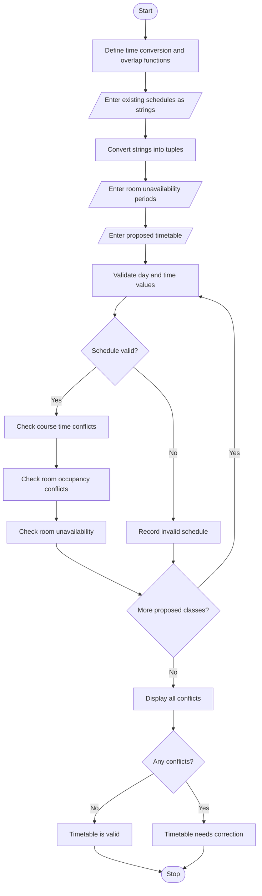

# Student Timetable Conflict Detection

## 1. Problem Statement

Develop a Python program to detect timetable conflicts by comparing course schedules represented using strings and tuples. The program should identify overlapping class periods, detect unavailable or double-booked rooms, and validate a proposed timetable before it is finalized.

The program should:
- Store course schedules using tuples containing course name, day, start time, end time, and room.
- Accept schedule information as strings and convert it into structured tuples.
- Detect overlapping periods for classes scheduled on the same day.
- Identify room conflicts when two classes are assigned the same room at overlapping times.
- Check whether a room is unavailable during a proposed class period.
- Validate a proposed timetable and report all detected conflicts.

**Assumptions:**
- Time is represented in 24-hour `HH:MM` format.
- A class conflicts with another class when their time intervals overlap on the same day.
- Two classes can occur at the same time if they use different rooms and belong to different student groups.
- In this program, all courses belong to the same student, so overlapping class periods are treated as student timetable conflicts.
- Room unavailability is provided as a list of unavailable time intervals for specific rooms.
- The end time of one class may equal the start time of another without creating a conflict.

## 2. Algorithm

1. Start the program.
2. Define a function to convert time strings into minutes.
3. Define a function to compare two time intervals.
4. Accept existing course schedules as strings.
5. Convert each schedule string into a tuple containing course, day, start time, end time, and room.
6. Input room unavailability periods.
7. Accept the proposed timetable.
8. Validate each proposed schedule:
   - Check that the day and time values are valid.
   - Ensure that the start time is earlier than the end time.
   - Check for overlapping periods with existing courses.
   - Check whether the assigned room is already occupied.
   - Check whether the room is unavailable during the proposed period.
9. Record all detected conflicts.
10. Display the proposed timetable and validation results.
11. If no conflicts exist, mark the timetable as valid.
12. Otherwise, display the conflicts that must be resolved.
13. Stop the program.

## 3. Flowchart Using Mermaid

## 5. Sample Input

Enter number of existing classes: 2
Enter existing schedule 1 (Course,Day,Start,End,Room): Mathematics,Monday,09:00,10:00,R101
Enter existing schedule 2 (Course,Day,Start,End,Room): Physics,Monday,10:00,11:00,R102

Enter number of room unavailability periods: 1
Unavailability period 1
Room: R103
Day: Monday
Unavailable start time (HH:MM): 11:00
Unavailable end time (HH:MM): 12:00

Enter number of proposed classes: 2
Enter proposed schedule 1 (Course,Day,Start,End,Room): Chemistry,Monday,09:30,10:30,R104
Enter proposed schedule 2 (Course,Day,Start,End,Room): ComputerScience,Monday,11:00,12:00,R103

## 6. Sample Output
STUDENT TIMETABLE CONFLICT DETECTION

--- PROPOSED TIMETABLE ---
('Chemistry', 'Monday', '09:30', '10:30', 'R104')
('ComputerScience', 'Monday', '11:00', '12:00', 'R103')

--- VALIDATION RESULTS ---
Timetable validation failed.
- Chemistry: Time conflict with Mathematics on Monday.
- Chemistry: Time conflict with Physics on Monday.
- ComputerScience: Room R103 is unavailable on Monday from 11:00 to 12:00.
