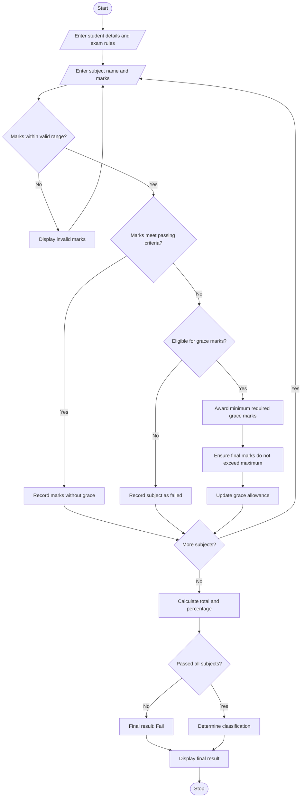

# Examination Result and Grace-Mark Validation

## 1. Problem Statement

Develop a Python program to process examination marks across multiple subjects, validate marks against maximum limits, apply subject-wise passing criteria, and implement a specified grace-mark policy. The program should determine whether a student passes or fails, calculate total marks and percentage, and generate a final classification.

The program should:
- Accept student details and marks for multiple subjects.
- Validate that marks are within the permitted range.
- Check each subject against its minimum passing marks.
- Apply grace marks to eligible subjects according to the specified policy.
- Ensure that grace marks never cause a subject's marks to exceed its maximum.
- Determine the final result and classification.
- Display the original marks, grace marks awarded, final marks, total, percentage, and result.

**Assumptions for this program:**
- Each subject has a maximum of 100 marks.
- The minimum passing mark is 35 per subject.
- A student may receive up to 5 grace marks in total.
- Grace marks may be awarded to a subject that is short by no more than 5 marks.
- Grace marks are awarded only as needed to bring a subject to the passing mark.
- Grace marks cannot increase a subject's marks above 100.
- Classification is based on the final percentage:
  - 75% and above: Distinction
  - 60% to below 75%: First Class
  - 50% to below 60%: Second Class
  - 35% to below 50%: Pass Class
  - Below 35%: Fail

*These are illustrative examination rules. Actual grace-mark and classification policies vary by institution.*

## 2. Algorithm

1. Start the program.
2. Input the student's name and number of subjects.
3. Input the maximum marks, passing marks, and grace-mark limit.
4. For each subject:
   - Enter the subject name and marks obtained.
   - Validate that marks are between 0 and the maximum marks.
   - Check whether the student has passed the subject.
   - If the student has failed narrowly, check grace-mark eligibility.
   - Award the minimum required grace marks without exceeding the subject maximum or the overall grace limit.
   - Update the final marks and remaining grace-mark allowance.
5. Check whether the student has passed every subject after applying grace marks.
6. Calculate total marks and percentage.
7. Determine the final classification.
8. Display subject-wise results, grace marks awarded, total marks, percentage, and classification.
9. Stop the program.

## 3. Flowchart Using Mermaid

## 5. Sample Input

Enter student name: Ananya
Enter number of subjects: 4

--- Subject 1 ---
Enter subject name: Mathematics
Enter marks obtained (0-100): 78

--- Subject 2 ---
Enter subject name: Science
Enter marks obtained (0-100): 32

--- Subject 3 ---
Enter subject name: English
Enter marks obtained (0-100): 65

--- Subject 4 ---
Enter subject name: Computer Science
Enter marks obtained (0-100): 34

## 6. Sample Output

EXAMINATION RESULT AND GRACE-MARK VALIDATION

--- SUBJECT-WISE RESULT ---

Subject: Mathematics
Original Marks: 78.00
Grace Marks: 0.00
Final Marks: 78.00
Status: Pass

Subject: Science
Original Marks: 32.00
Grace Marks: 3.00
Final Marks: 35.00
Status: Pass

Subject: English
Original Marks: 65.00
Grace Marks: 0.00
Final Marks: 65.00
Status: Pass

Subject: Computer Science
Original Marks: 34.00
Grace Marks: 1.00
Final Marks: 35.00
Status: Pass

--- FINAL RESULT ---
Student Name: Ananya
Total Marks: 213.00/400
Percentage: 53.25%
Grace Marks Used: 4.00/5
Classification: Second Class
