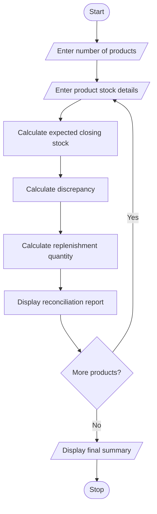

# Warehouse Inventory Reconciliation Using Python

## 1. Problem Statement

Warehouse Inventory Reconciliation is a Python program designed to compare the opening stock, incoming quantities, dispatched quantities, and actual closing stock of multiple products in a warehouse.

The program calculates the expected closing stock for each product and compares it with the actual closing stock to identify discrepancies. It also calculates replenishment requirements based on a predefined minimum stock level.

The program performs the following operations:

1. Accept the number of products in the warehouse.
2. Read each product's name, opening stock, incoming quantity, dispatched quantity, actual closing stock, and minimum stock level.
3. Calculate the expected closing stock using the formula:

   **Expected Closing Stock = Opening Stock + Incoming Quantity − Dispatched Quantity**

4. Compare the expected closing stock with the actual closing stock.
5. Identify discrepancies between expected and actual stock.
6. Calculate the replenishment quantity when the closing stock falls below the minimum stock level.
7. Display an inventory reconciliation report for all products.

**Assumptions:**
- Stock quantities are non-negative whole numbers.
- Dispatched quantities cannot exceed the available stock.
- A discrepancy is calculated as actual closing stock minus expected closing stock.
- Replenishment brings the actual closing stock up to the specified minimum stock level.

## 2. Algorithm

1. **Start** the program.
2. Input the number of products.
3. Initialize the inventory report.
4. For each product:
   - Input product name.
   - Input opening stock, incoming quantity, dispatched quantity, actual closing stock, and minimum stock level.
   - Calculate expected closing stock.
   - Calculate the discrepancy between actual and expected closing stock.
   - Determine whether the stock matches, has a shortage, or has a surplus.
   - Calculate the replenishment quantity if the actual closing stock is below the minimum stock level.
   - Display the product's reconciliation details.
5. Repeat Step 4 for all products.
6. Display the final inventory reconciliation summary.
7. **Stop** the program.

## 3. Flowchart Using Mermaid

## 5. Sample Input

Enter number of products: 3

Product 1
Enter product name: Laptop
Enter opening stock: 50
Enter incoming quantity: 20
Enter dispatched quantity: 30
Enter actual closing stock: 40
Enter minimum stock level: 25

Product 2
Enter product name: Keyboard
Enter opening stock: 100
Enter incoming quantity: 20
Enter dispatched quantity: 50
Enter actual closing stock: 65
Enter minimum stock level: 80

Product 3
Enter product name: Mouse
Enter opening stock: 80
Enter incoming quantity: 10
Enter dispatched quantity: 30
Enter actual closing stock: 65
Enter minimum stock level: 4

## 6. Sample Outpuy
========== INVENTORY RECONCILIATION REPORT ==========

Product Name       : Laptop
Opening Stock      : 50
Incoming Quantity  : 20
Dispatched Quantity: 30
Expected Closing   : 40
Actual Closing     : 40
Discrepancy        : 0
Stock Status       : Matched
Replenishment      : 0

Product Name       : Keyboard
Opening Stock      : 100
Incoming Quantity  : 20
Dispatched Quantity: 50
Expected Closing   : 70
Actual Closing     : 65
Discrepancy        : -5
Stock Status       : Stock Shortage
Replenishment      : 15

Product Name       : Mouse
Opening Stock      : 80
Incoming Quantity  : 10
Dispatched Quantity: 30
Expected Closing   : 60
Actual Closing     : 65
Discrepancy        : 5
Stock Status       : Stock Surplus
Replenishment      : 0

========== FINAL SUMMARY ==========
Total products processed: 3
Products with matching stock: 1
Products with shortages: 1
Products with surpluses: 1
Total replenishment required: 15

Inventory reconciliation completed.

