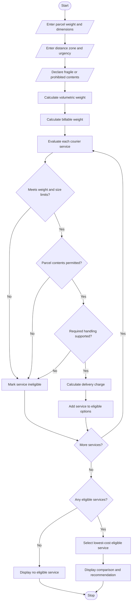

# 4. Courier Charge Optimization

## 1. Problem Statement

Develop a Python program to calculate courier delivery charges based on parcel weight, dimensions, delivery distance zones, urgency, and declared restrictions. The program should compare multiple courier service options, determine which services satisfy the parcel's requirements, and select the most economical eligible service.

The program should:
- Accept parcel weight, length, width, and height.
- Calculate volumetric weight and determine the billable weight.
- Calculate charges according to the distance zone.
- Apply additional charges for urgent delivery.
- Check parcel restrictions, such as prohibited items and maximum weight or size limits.
- Compare standard, express, and priority courier services.
- Select the lowest-cost service among eligible options.
- Display the charge breakdown and explain why any service is ineligible.

**Assumptions for this program:**

**Volumetric weight:**

\[
\text{Volumetric Weight (kg)} =
\frac{\text{Length} \times \text{Width} \times \text{Height}}{5000}
\]

Dimensions are measured in centimetres.

**Billable weight:**

\[
\text{Billable Weight} =
\max(\text{Actual Weight},\text{Volumetric Weight})
\]

**Illustrative pricing rules:**

| Distance zone | Base charge per kg |
|---|---:|
| Local | ₹40 |
| Regional | ₹70 |
| National | ₹100 |

Additional charges:
- Standard delivery: No urgency surcharge.
- Express delivery: 25% surcharge.
- Priority delivery: 50% surcharge.
- Handling fee: ₹30 per parcel.
- Maximum weight: 20 kg for Standard, 15 kg for Express, and 10 kg for Priority.
- Maximum parcel dimension: 100 cm per side.
- Prohibited items are not accepted by any service.
- Declared fragile parcels require a service that supports fragile-item handling.

*These prices and restrictions are illustrative and do not represent actual courier company policies.*

## 2. Algorithm

1. Start the program.
2. Input parcel weight and dimensions.
3. Input the distance zone and delivery urgency.
4. Ask whether the parcel contains prohibited or fragile items.
5. Calculate the volumetric weight.
6. Determine the billable weight using the greater of actual and volumetric weight.
7. Calculate the base delivery charge for each courier service.
8. Apply the appropriate urgency surcharge and handling fee.
9. Check each service against:
   - Maximum weight.
   - Maximum dimension.
   - Prohibited-item restrictions.
   - Fragile-item handling requirements.
   - Required delivery urgency.
10. Mark each service as eligible or ineligible.
11. Compare the charges of all eligible services.
12. Select the eligible service with the lowest charge.
13. Display the service comparison, rejection reasons, and recommended service.
14. Stop the program.

## 3. Flowchart Using Mermaid

## 5. Sample Input

Enter parcel weight (kg): 4
Enter length (cm): 30
Enter width (cm): 20
Enter height (cm): 15

Enter distance zone (Local/Regional/National): Regional
Enter required urgency (Standard/Express/Priority): Express

Does the parcel contain fragile items? (yes/no): yes
Does the parcel contain prohibited items? (yes/no): no

## 6. Sample Output

COURIER CHARGE OPTIMIZATION

Volumetric Weight: 1.80 kg
Billable Weight: 4.00 kg

--- COURIER SERVICE COMPARISON ---

Standard: Ineligible
  - Fragile-item handling unavailable
  - Does not meet express urgency

Service: Express
Base Charge: Rs. 280.00
Urgency Surcharge: Rs. 70.00
Handling Fee: Rs. 30.00
Total Charge: Rs. 380.00
Eligibility: Eligible

Priority: Ineligible
  - Does not meet priority urgency

--- RECOMMENDATION ---
Selected Service: Express
Minimum Charge: Rs. 380.00
cal logistics problems.
