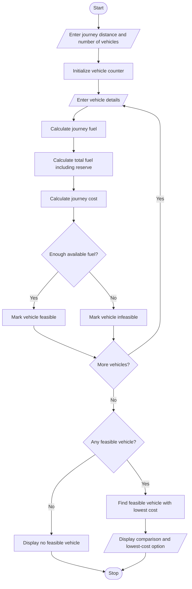

# Fuel Consumption and Route Comparison Using Python

## 1. Problem Statement

Develop a Python program to calculate fuel requirements and journey costs for several vehicles traveling a specified distance. The program should consider each vehicle’s mileage, fuel price, and required reserve fuel. It must determine the total fuel needed, estimate the journey cost, check whether each vehicle has enough fuel available, and identify the **lowest-cost feasible vehicle**.

### Requirements
- Accept the journey distance in kilometres.
- Accept details for multiple vehicles:
  - Vehicle name
  - Mileage in km/litre
  - Fuel price per litre
  - Available fuel in litres
  - Required reserve fuel in litres
- Calculate the fuel required for the journey, including the reserve.
- Calculate the total journey fuel cost.
- Determine whether each vehicle has enough fuel.
- Identify the feasible vehicle with the lowest journey cost.

**Assumption:** The vehicle must have enough fuel to complete the journey and retain its required reserve. Fuel cost is calculated using the total fuel required for the journey, excluding the reserve because the reserve is not consumed.

## 2. Algorithm

1. Start.
2. Input the journey distance.
3. Input the number of vehicles.
4. For each vehicle:
   - Enter its name, mileage, fuel price, available fuel, and reserve requirement.
   - Calculate journey fuel:
     \[
     \text{Journey Fuel}=\frac{\text{Distance}}{\text{Mileage}}
     \]
   - Calculate total fuel required:
     \[
     \text{Total Fuel Required}=\text{Journey Fuel}+\text{Reserve Fuel}
     \]
   - Calculate journey cost:
     \[
     \text{Journey Cost}=\text{Journey Fuel}\times\text{Fuel Price}
     \]
   - Check whether available fuel is greater than or equal to total fuel required.
5. Display the fuel requirement, journey cost, and feasibility of each vehicle.
6. Among feasible vehicles, identify the one with the lowest journey cost.
7. If no vehicle is feasible, display an appropriate message.
8. Stop.

## 3. Flowchart

## 5. Sample Input

FUEL CONSUMPTION AND ROUTE COMPARISON
Enter journey distance (km): 300
Enter number of vehicles: 3

Enter details for Vehicle 1
Vehicle name: Car A
Mileage (km/litre): 15
Fuel price per litre (Rs.): 105
Available fuel (litres): 30
Required reserve (litres): 5

Enter details for Vehicle 2
Vehicle name: Car B
Mileage (km/litre): 20
Fuel price per litre (Rs.): 100
Available fuel (litres): 25
Required reserve (litres): 3

Enter details for Vehicle 3
Vehicle name: SUV C
Mileage (km/litre): 10
Fuel price per litre (Rs.): 105
Available fuel (litres): 40
Required reserve (litres): 5

## 6. Sample Output

--- VEHICLE COMPARISON REPORT ---
Journey Distance: 300.00 km

Vehicle: Car A
Journey Fuel: 20.00 litres
Total Fuel Required (including reserve): 25.00 litres
Journey Cost: Rs. 2100.00
Status: Feasible

Vehicle: Car B
Journey Fuel: 15.00 litres
Total Fuel Required (including reserve): 18.00 litres
Journey Cost: Rs. 1500.00
Status: Feasible

Vehicle: SUV C
Journey Fuel: 30.00 litres
Total Fuel Required (including reserve): 35.00 litres
Journey Cost: Rs. 3150.00
Status: Feasible

--- BEST OPTION ---
Lowest-Cost Vehicle: Car B
Estimated Journey Cost: Rs. 1500.00
This vehicle has enough fuel, including its reserve.

Thus, the program helps users compare vehicles and make economical journey-planning decisions.
