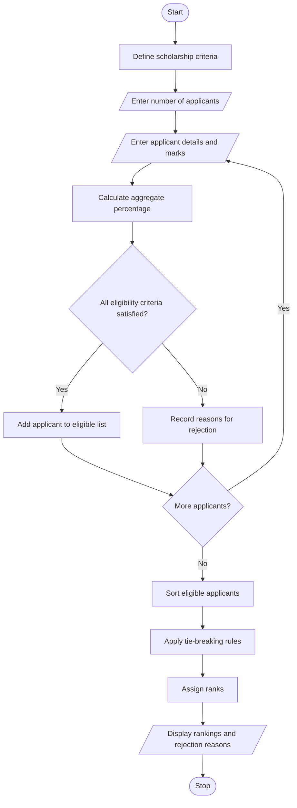

# University Scholarship Allocation Using Python

## 1. Problem Statement

Develop a Python program to allocate university scholarships by evaluating applicants based on aggregate marks, subject-wise minimum scores, attendance percentage, and family income. The program should identify eligible applicants, rank them according to predefined criteria, and resolve ties fairly.

The system should perform the following tasks:

- Accept applicant details, including name, ID, subject marks, attendance percentage, and annual family income.
- Calculate the aggregate percentage of each applicant.
- Verify minimum subject-wise marks.
- Check attendance and family income requirements.
- Identify eligible and ineligible applicants with reasons.
- Rank eligible applicants using aggregate marks and predefined tie-breaking rules.
- Display the final scholarship ranking.

### Example Scholarship Rules

| Criterion | Requirement |
|---|---|
| Aggregate marks | At least 75% |
| Mathematics | At least 60 marks |
| Science | At least 60 marks |
| English | At least 50 marks |
| Attendance | At least 85% |
| Annual family income | Not more than ₹300,000 |

**Ranking and tie-breaking rules:**
1. Higher aggregate percentage ranks first.
2. If aggregate percentages are equal, higher combined Mathematics and Science marks rank first.
3. If both criteria are equal, higher attendance ranks first.
4. If all previous criteria are equal, the lower applicant ID ranks first.

These are example rules for an academic project. Actual scholarship requirements may differ by university.

## 2. Algorithm

1. Start.
2. Define the minimum aggregate, subject-wise marks, attendance, and maximum family income.
3. Input the number of scholarship applicants.
4. For each applicant:
   - Enter applicant ID and name.
   - Enter Mathematics, Science, and English marks.
   - Enter attendance percentage and annual family income.
   - Calculate the aggregate percentage.
5. Check whether the applicant satisfies all eligibility criteria.
6. If any criterion is not satisfied, record the reason for ineligibility.
7. Add eligible applicants to the scholarship list.
8. Sort eligible applicants using the predefined ranking and tie-breaking rules.
9. Assign ranks to eligible applicants.
10. Display the ranked scholarship list and rejected applicants with reasons.
11. Stop.

## 3. Flowchart (Mermaid)

## 5. Sample Input

Enter number of applicants: 3

Applicant 1
Enter applicant ID: 101
Enter applicant name: Asha
Enter Mathematics marks (0-100): 90
Enter Science marks (0-100): 88
Enter English marks (0-100): 92
Enter attendance percentage (0-100): 95
Enter annual family income (Rs.): 200000

Applicant 2
Enter applicant ID: 102
Enter applicant name: Bharat
Enter Mathematics marks (0-100): 95
Enter Science marks (0-100): 83
Enter English marks (0-100): 92
Enter attendance percentage (0-100): 90
Enter annual family income (Rs.): 250000

Applicant 3
Enter applicant ID: 103
Enter applicant name: Charan
Enter Mathematics marks (0-100): 55
Enter Science marks (0-100): 65
Enter English marks (0-100): 70
Enter attendance percentage (0-100): 80
Enter annual family income (Rs.): 400000

## 6. Sample Output

========== SCHOLARSHIP RANKING ==========
Rank  ID      Name           Aggregate    Attendance
-------------------------------------------------------
1     101     Asha           90.00%       95.00%
2     102     Bharat         90.00%       90.00%

Total eligible applicants: 2

========== INELIGIBLE APPLICANTS ==========

Charan (ID: 103)
- Mathematics marks below 60
- Aggregate below 75%
- Attendance below 85%
- Annual family income exceeds Rs. 300000

