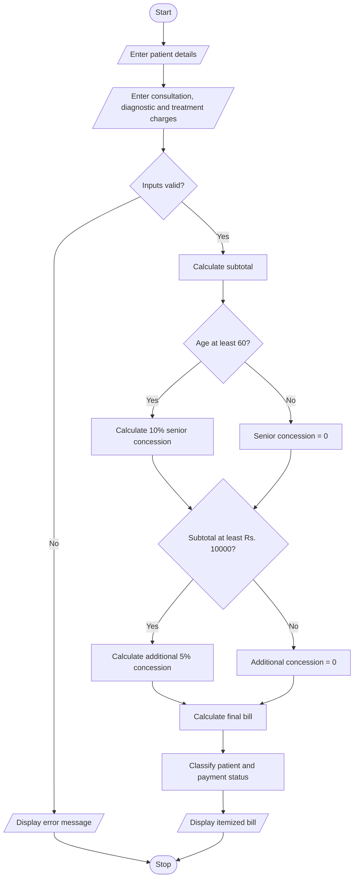

# Hospital Billing and Patient Classification Using Python

## 1. Problem Statement

Develop a Python program to calculate hospital bills by processing consultation fees, diagnostic charges, and treatment costs. The program should apply conditional concessions, validate billing constraints, and classify patients according to a predefined payment policy.

The program should:
- Accept patient details and consultation, diagnostic, and treatment charges.
- Calculate the total bill.
- Apply concessions based on patient category and bill amount.
- Validate inputs to prevent negative charges and invalid concession calculations.
- Calculate the final payable amount.
- Classify patients according to their payment status and final bill amount.
- Display an itemized billing summary.

### Example Billing and Classification Policy

**Billing rules:**

| Component | Example rule |
|---|---|
| Consultation fee | Entered by the user |
| Diagnostic charges | Entered by the user |
| Treatment charges | Entered by the user |
| Senior citizen concession | 10% discount for patients aged 60 or above |
| High-bill concession | Additional 5% discount if the subtotal is at least ₹10,000 |
| Maximum total concession | 15% of the subtotal |

For this example, concessions are calculated on the original subtotal. The high-bill concession is added to the senior citizen concession when both conditions are satisfied.

**Patient classification policy:**

| Final bill amount | Classification |
|---|---|
| ₹0 | No Payment Due |
| ₹1–₹5,000 | Standard |
| ₹5,001–₹15,000 | Moderate |
| Above ₹15,000 | High-Cost |

The program also records whether payment is pending or paid.

*These are illustrative rules for a programming assignment, not actual hospital billing or medical policies.*

## 2. Algorithm

1. Start.
2. Input the patient's ID, name, age, and payment status.
3. Input consultation, diagnostic, and treatment charges.
4. Validate the inputs:
   - Age must not be negative.
   - Charges must not be negative.
   - Payment status must be either `Paid` or `Pending`.
5. Calculate the subtotal by adding all three charges.
6. If the patient is 60 or older, calculate a 10% senior citizen concession.
7. If the subtotal is at least ₹10,000, calculate an additional 5% concession.
8. Calculate the total concession and ensure it does not exceed 15% of the subtotal.
9. Calculate the final payable amount.
10. Classify the patient according to the final bill amount.
11. Display the itemized bill, concessions, final amount, classification, and payment status.
12. Stop.

## 3. Flowchart (Mermaid)

## 5. Sample Input

HOSPITAL BILLING AND PATIENT CLASSIFICATION
Enter patient ID: P101
Enter patient name: Ravi
Enter patient age: 65
Enter consultation charges (Rs.): 1000
Enter diagnostic charges (Rs.): 3000
Enter treatment charges (Rs.): 8000
Enter payment status (Paid/Pending): Pending

## 6. Sample Output

========== HOSPITAL BILL ==========
Patient ID: P101
Patient Name: Ravi
Age: 65

--- Charge Details ---
Consultation: Rs. 1000.00
Diagnostics: Rs. 3000.00
Treatment: Rs. 8000.00
Subtotal: Rs. 12000.00

--- Concessions ---
Senior Citizen Discount: Rs. 1200.00
High-Bill Discount: Rs. 600.00
Total Discount: Rs. 1800.00

--- Final Summary ---
Final Bill: Rs. 10200.00
Patient Classification: Moderate
Payment Status: Pending
Amount Due: Rs. 10200.00

