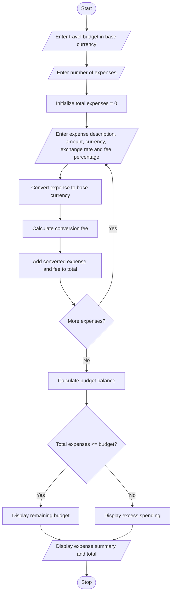

# Multi-Currency Travel Budget Analysis

## 1. Problem Statement
Develop a Python program to analyze a travel budget involving expenses in multiple currencies. The program should convert expenses into a base currency using supplied exchange rates, incorporate currency conversion fees, calculate total travel expenses, compare the total with the planned budget, and display the remaining balance or excess amount.

## 2. Algorithm
1. Start the program.
2. Input the travel budget in the base currency (e.g., INR).
3. Input the number of travel expenses.
4. For each expense:
   - Enter the expense description.
   - Enter the expense amount and currency code.
   - Enter the exchange rate relative to the base currency.
   - Enter the currency conversion fee percentage.
   - Convert the expense into the base currency.
   - Calculate the conversion fee.
   - Add the converted amount and fee to the total expenses.
5. Compare the total expenses with the planned budget.
6. Calculate the remaining budget or excess spending.
7. Display the expense details, total expenses, and budget status.
8. Stop the program.

## 3. Flowchart Using Mermaid

## 5. Sample Input

Enter base currency code (e.g., INR): INR
Enter your travel budget: 50000
Enter number of expenses: 2

Expense 1
Enter expense description: Hotel
Enter expense amount: 200
Enter expense currency code: USD
Enter exchange rate (1 USD in INR): 85
Enter conversion fee percentage: 2

Expense 2
Enter expense description: Food
Enter expense amount: 100
Enter expense currency code: EUR
Enter exchange rate (1 EUR in INR): 95
Enter conversion fee percentage: 1

## 6. Sample Output

MULTI-CURRENCY TRAVEL BUDGET ANALYSIS

Expense 1
Description: Hotel
Original amount: 200.00 USD
Converted amount: 17000.00 INR
Conversion fee: 340.00 INR
Total expense: 17340.00 INR

Expense 2
Description: Food
Original amount: 100.00 EUR
Converted amount: 9500.00 INR
Conversion fee: 95.00 INR
Total expense: 9595.00 INR

--- TRAVEL BUDGET SUMMARY ---
Planned budget: 50000.00 INR
Total expenses: 26935.00 INR
Remaining budget: 23065.00 INR
Status: Within budget

]
