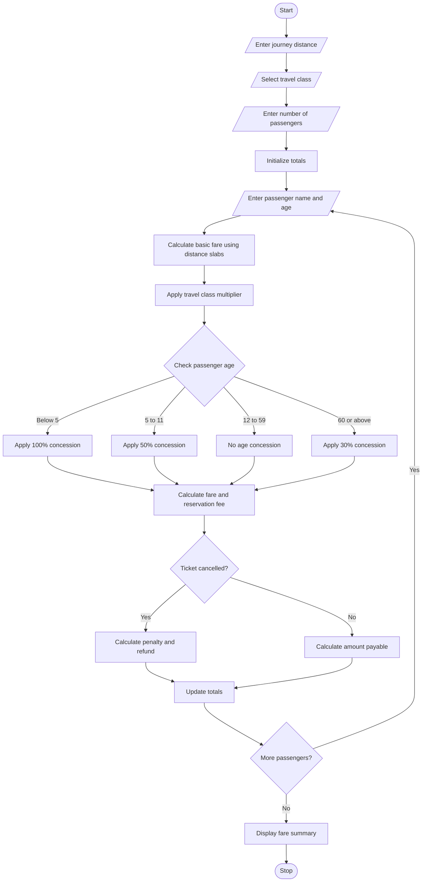

# Railway Fare and Reservation Calculator

## 1. Problem Statement

Develop a Python program to calculate railway fares and reservation charges for multiple passengers. The program should consider the travel distance, travel class, age-based concessions, reservation fees, and cancellation penalties.

The program should:
- Accept passenger details, including name and age.
- Calculate the basic fare based on distance slabs.
- Apply the fare multiplier for the selected travel class.
- Provide age-based concessions for eligible passengers.
- Add reservation fees to the final fare.
- Calculate cancellation penalties when a ticket is cancelled.
- Display the fare breakdown and total amount payable or refundable.

**Assumptions for this program:**
- Distance up to 100 km: ₹1.50 per km.
- Distance from 101 to 300 km: ₹1.25 per km.
- Distance above 300 km: ₹1.00 per km.
- Travel classes: Sleeper (1.0×), AC 3-Tier (1.5×), and AC 2-Tier (2.0×).
- Children below 5 years travel free.
- Passengers aged 5–11 receive a 50% concession.
- Passengers aged 60 and above receive a 30% concession.
- Reservation fee: ₹40 per passenger, except children travelling free.
- Cancellation penalty: 25% of the final fare before cancellation.

*These are illustrative rules for the assignment, not actual railway fare policies.*

## 2. Algorithm

1. Start the program.
2. Input the journey distance in kilometres.
3. Select the travel class.
4. Input the number of passengers.
5. For each passenger:
   - Enter the passenger's name and age.
   - Calculate the basic fare according to the distance slabs.
   - Apply the selected class multiplier.
   - Determine the age-based concession.
   - Calculate the fare after concession.
   - Add the reservation fee if applicable.
   - Ask whether the ticket is cancelled.
   - If cancelled, calculate the cancellation penalty and refund.
   - Otherwise, calculate the amount payable.
6. Calculate the total amount payable and total refund for all passengers.
7. Display each passenger's fare breakdown and the overall summary.
8. Stop the program.

## 3. Flowchart Using Mermaid

## 5. Sample Input

Enter journey distance (km): 250

Available Classes:
1. Sleeper
2. AC 3-Tier
3. AC 2-Tier

Select travel class (1/2/3): 2
Enter number of passengers: 2

--- Passenger 1 ---
Enter passenger name: Ravi
Enter passenger age: 30
Is the ticket cancelled? (yes/no): no

--- Passenger 2 ---
Enter passenger name: Meena
Enter passenger age: 65
Is the ticket cancelled? (yes/no): yes

## 6. Sample Output

RAILWAY FARE AND RESERVATION CALCULATOR

--- Passenger 1 ---
Passenger: Ravi
Age: 30
Basic fare: Rs. 337.50
Fare after class multiplier: Rs. 506.25
Age concession: 0%
Discount: Rs. 0.00
Reservation fee: Rs. 40.00
Final fare: Rs. 546.25
Amount payable: Rs. 546.25

--- Passenger 2 ---
Passenger: Meena
Age: 65
Basic fare: Rs. 337.50
Fare after class multiplier: Rs. 506.25
Age concession: 30%
Discount: Rs. 151.88
Reservation fee: Rs. 40.00
Final fare: Rs. 394.37
Cancellation penalty: Rs. 98.59
Refund amount: Rs. 295.78

--- JOURNEY SUMMARY ---
Distance: 250.00 km
Travel class: Ac 3-Tier
Total amount payable: Rs. 546.25
Total refunds: Rs. 295.78

