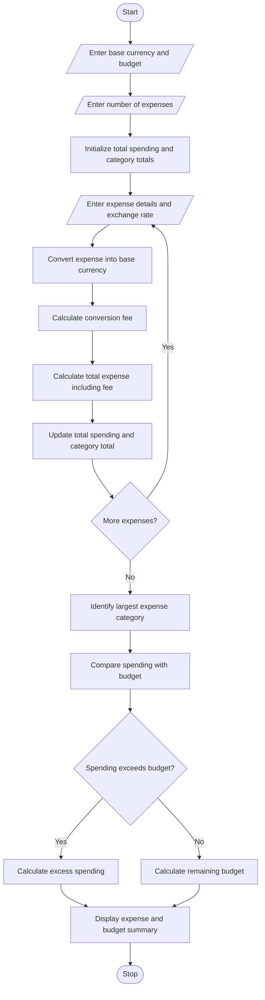

# Multi-Currency Travel Budget Analysis

## 1. Problem Statement

Develop a Python program to analyze a travel budget containing expenses in multiple currencies. The program should convert each expense into a selected base currency using supplied exchange rates, calculate currency conversion fees, compare total spending against the planned budget, and identify the largest expense category.

The program should:
- Accept the planned travel budget and base currency.
- Record multiple expenses with their categories, amounts, and currencies.
- Convert expenses into the base currency using supplied exchange rates.
- Calculate conversion fees for each expense.
- Calculate total expenses, including conversion fees.
- Compare total spending against the planned budget.
- Identify the category with the highest total expense.
- Display a detailed expense summary and budget status.

**Assumptions:**
- The user supplies the exchange rate for each expense.
- Conversion fees are entered as a percentage.
- All expenses are converted into one base currency, such as INR.
- The largest expense category is determined by comparing category totals, including conversion fees.

## 2. Algorithm

1. Start the program.
2. Input the base currency and planned budget.
3. Input the number of travel expenses.
4. Initialize the total spending and category totals.
5. For each expense:
   - Enter the expense description and category.
   - Enter the expense amount and currency code.
   - Enter the exchange rate relative to the base currency.
   - Enter the conversion fee percentage.
   - Convert the original amount into the base currency.
   - Calculate the conversion fee.
   - Add the converted amount and fee to the total spending.
   - Update the corresponding category total.
6. Identify the category with the highest total spending.
7. Compare total spending with the planned budget.
8. Calculate the remaining budget or excess spending.
9. Display the expense details, category totals, largest expense category, and budget status.
10. Stop the program.

## 3. Flowchart Using Mermaid

## 5. Sample Input

Enter base currency code (e.g., INR): INR
Enter planned travel budget: 50000
Enter number of expenses: 3

--- Expense 1 ---
Enter expense description: Hotel Booking
Enter expense category: Accommodation
Enter expense amount: 200
Enter currency code: USD
Enter exchange rate (1 USD in INR): 85
Enter conversion fee percentage: 2

--- Expense 2 ---
Enter expense description: Restaurant Meals
Enter expense category: Food
Enter expense amount: 100
Enter currency code: EUR
Enter exchange rate (1 EUR in INR): 95
Enter conversion fee percentage: 1

--- Expense 3 ---
Enter expense description: Museum Tickets
Enter expense category: Activities
Enter expense amount: 50
Enter currency code: EUR
Enter exchange rate (1 EUR in INR): 95
Enter conversion fee percentage: 1

## 6. Sample Output

MULTI-CURRENCY TRAVEL BUDGET ANALYSIS

--- EXPENSE DETAILS ---

Description: Hotel Booking
Category: Accommodation
Original Amount: 200.00 USD
Converted Amount: 17000.00 INR
Conversion Fee: 340.00 INR
Total Cost: 17340.00 INR

Description: Restaurant Meals
Category: Food
Original Amount: 100.00 EUR
Converted Amount: 9500.00 INR
Conversion Fee: 95.00 INR
Total Cost: 9595.00 INR

Description: Museum Tickets
Category: Activities
Original Amount: 50.00 EUR
Converted Amount: 4750.00 INR
Conversion Fee: 47.50 INR
Total Cost: 4797.50 INR

--- CATEGORY TOTALS ---
Accommodation: 17340.00 INR
Food: 9595.00 INR
Activities: 4797.50 INR

--- TRAVEL BUDGET SUMMARY ---
Planned Budget: 50000.00 INR
Total Expenses: 31732.50 INR
Largest Expense Category: Accommodation (17340.00 INR)
Remaining Budget: 18267.50 INR
Status: Within Budget

