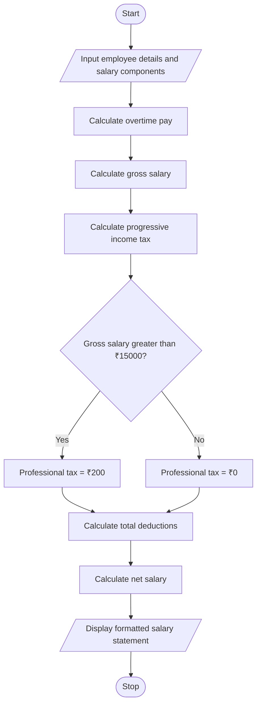

# Employee Payroll and Deduction Analysis Using Python

## 1. Problem Statement

Develop a Python program to calculate an employee’s gross salary using basic pay, allowances, overtime pay, and incentives. Apply progressive deductions based on the gross salary, calculate the net salary, and generate a formatted salary statement.

The program should:
- Accept employee details and salary components.
- Calculate allowances, overtime pay, and incentives.
- Calculate the gross salary.
- Apply progressive deductions based on predefined salary slabs.
- Calculate total deductions and net salary.
- Display a formatted salary statement.

## 2. Algorithm

1. Start.
2. Input the employee’s name and employee ID.
3. Input basic pay, allowances, overtime hours, overtime rate per hour, and incentives.
4. Calculate overtime pay:

   **Overtime Pay = Overtime Hours × Overtime Rate**

5. Calculate gross salary:

   **Gross Salary = Basic Pay + Allowances + Overtime Pay + Incentives**

6. Calculate progressive tax deductions using the following illustrative slabs:
   - First ₹20,000: 0% tax.
   - Next ₹20,000: 5% tax.
   - Amount above ₹40,000: 10% tax.
7. Calculate a fixed professional tax of ₹200 if gross salary exceeds ₹15,000.
8. Calculate total deductions:

   **Total Deductions = Income Tax + Professional Tax**

9. Calculate net salary:

   **Net Salary = Gross Salary − Total Deductions**

10. Display the formatted salary statement.
11. Stop.

*Note: The deduction rates are illustrative for this programming exercise, not a statement of actual tax rules.*

## 3. Flowchart Using Mermaid

## 5. Sample Input

Enter Employee ID: E102
Enter Employee Name: Ravi
Enter Basic Pay (₹): 30000
Enter Total Allowances (₹): 5000
Enter Overtime Hours: 10
Enter Overtime Rate per Hour (₹): 200
Enter Incentives (₹): 3000

## 6. Sample Output

=============================================
             SALARY STATEMENT
=============================================
Employee ID          : E102
Employee Name        : Ravi
---------------------------------------------
Basic Pay            : ₹30,000.00
Allowances           : ₹5,000.00
Overtime Pay         : ₹2,000.00
Incentives           : ₹3,000.00
---------------------------------------------
Gross Salary         : ₹40,000.00
---------------------------------------------
Progressive Income Tax: ₹1,000.00
Professional Tax     : ₹200.00
Total Deductions     : ₹1,200.00
---------------------------------------------
NET SALARY           : ₹38,800.00
=============================================
